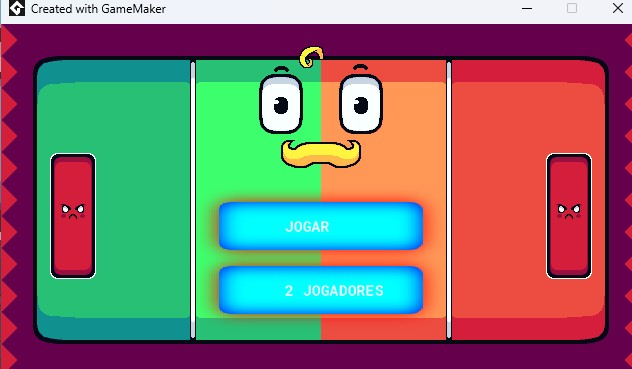

# Pong Game - GameMaker

## Sobre o projeto

Recriação do clássico jogo Pong, desenvolvida no GameMaker utilizando GML (GameMaker Language).

O projeto foi realizado durante o curso da None Class, como parte dos meus estudos em programação e desenvolvimento de jogos.

O jogo possui modos para 1 e 2 jogadores.

## Modos de jogo

O projeto possui dois modos de jogo:

- **1 jogador:** modo para jogar individualmente.
- **2 jogadores:** modo para duas pessoas jogarem uma contra a outra.

## Tecnologias utilizadas

- GameMaker
- GML (GameMaker Language)

## Origem do projeto

Jogo desenvolvido durante o curso da None Class, com foco na prática de lógica de programação e desenvolvimento de jogos.

## Imagem do jogo

